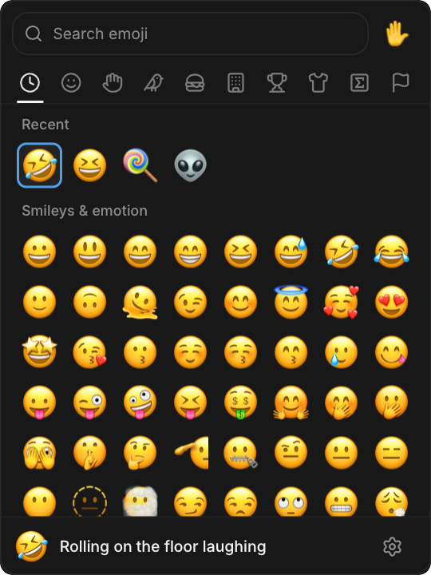
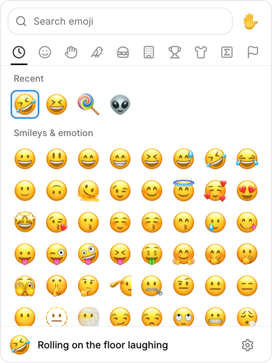

<p align="center">
  
</p>

<h1 align="center">cuimoji</h1>

<p align="center">
  <a href="https://github.com/NoCrypt/cuimoji/releases/latest"></a>
  <a href="LICENSE"></a>
  
</p>

A small, fast emoji picker for Linux. Open it with a shortcut, type or click an
emoji, and cuimoji pastes it into the app you were already using.

It starts in about 40 ms, uses ~12 MB of memory on Wayland (~8–11 MB on X11),
and has no background service: it only runs while the picker is open.

<p align="center">
  
  
</p>

<p align="center"><em>Dark and light theme.</em></p>

## What you get

- **Search that understands you** — search by name, tags, or shortcodes:
  “burger”, “hungry”, and “rofl” all find the right emoji.
- **Recents and groups** — your most-used emoji are always first; the nine
  groups (smileys, people, animals, food, places, activities, objects, symbols,
  flags) have simple icons.
- **Skin tones** — pick a tone once and the people/hand emoji follow it,
  including with Apple Color Emoji.
- **Your own fonts** — use the system emoji font, Apple Color Emoji, or drop a
  font into `~/.local/share/cuimoji/emoji/`.
- **Quick paste** — the picker disappears, your previous app gets focus back,
  and the emoji is pasted. Terminals get Ctrl+Shift+V automatically.
- **Single instance** — pressing your shortcut again closes the picker instead
  of opening another window.
- **No daemon, portal, or D-Bus service** — nothing keeps running in the
  background, and no data leaves your machine.

## Install

```sh
curl -fsSL https://raw.githubusercontent.com/NoCrypt/cuimoji/main/linux/install.sh | sh
```

This installs the latest prebuilt release for your user in
`~/.local/lib/cuimoji`; no build tools are needed. It adds a `cuimoji` command
in `~/.local/bin` and an application-menu entry. If SDL2, Wayland, X11, Vulkan,
or `wl-clipboard` are missing, the script installs the distro packages (it asks
for your password). The release is for x86_64 Linux with glibc 2.35 or newer.

Uninstall with:

```sh
~/.local/lib/cuimoji/install.sh --uninstall
```

Running the installer again when cuimoji is already installed asks whether to
upgrade or remove it.

### Other install options

The [releases page](https://github.com/NoCrypt/cuimoji/releases) also has:

- **AppImage** — `chmod +x cuimoji-0.2-linux-x86_64.AppImage` and run it. It
  needs FUSE 2, or run it with `--appimage-extract-and-run`.
- **Flatpak** — `flatpak install --user cuimoji-0.2-x86_64.flatpak`. This uses
  the `org.freedesktop.Platform` 25.08 runtime; custom emoji fonts go in
  `~/.local/share/cuimoji/emoji/`.
- **Arch Linux** — `sudo pacman -U cuimoji-0.2-1-x86_64.pkg.tar.zst`.
- **Tarball** — the plain binary, font, icon and installer.

All release builds are for x86_64 Linux.

## Build from source

You need a C compiler, CMake, `libx11`, and — for the native Wayland window —
`sdl2` and `wayland-client`. The optional Vulkan renderer needs
`vulkan-headers`.

```sh
cmake -S . -B build -DCMAKE_BUILD_TYPE=Release
cmake --build build -j
./build/cuimoji
```

The first configure downloads CUI (the UI toolkit) and the emoji search data, so
it needs an internet connection once. Later builds work offline.

For auto-paste, also install `wl-clipboard` (`wl-copy`) and make sure your user
can open `/dev/uinput` — usually by being in the `input` group. If that is not
possible, cuimoji falls back to `ydotool` when it is installed.

## Using it

| Key | What it does |
|---|---|
| Type | Start searching |
| ↑ / ↓ / ← / → | Move around the grid |
| Enter | Pick the selected emoji |
| Esc | Close without picking |
| F1 | Open settings |
| F2 | Switch to the next emoji set |

Or just click an emoji. The bar at the bottom shows the name of the emoji under
the pointer and has the settings gear on the right.

### Settings

- **Theme** — dark or light.
- **Emoji set** — System (Noto Color Emoji), Apple Color Emoji, Fluent Emoji
  (Color, Flat, or High Contrast), or any other installed emoji font (One UI
  Emoji, OpenMoji, Twemoji, JoyPixels, …) found through fontconfig. Monochrome
  emoji fonts are drawn in the current text color. You can also drop a font
  into `~/.local/share/cuimoji/emoji/`.
- **Emoji size** — 24–128 px.
- **UI size** — 90–150%. This zooms the whole interface, including text,
  controls, and emoji.
- **Paste delay** — only used when cuimoji cannot ask the compositor which
  window has focus. The default is fine for most setups.
- **Renderer** — Software is recommended. OpenGL and Vulkan are available;
  changes take effect on the next launch.
- **Window system** — Auto is recommended. Choose X11 if you have trouble with
  the native Wayland window. Changes take effect on the next launch.

The window can be resized from 240×240 to 770×770, and cuimoji remembers its
size. On X11 it also remembers where it was.

### Optional: theme file

For deeper customisation, cuimoji creates a commented theme file at
`$XDG_STATE_HOME/cuimoji/theme`. It can change the semantic colors, tone
colors, corner radii, control and text sizes, shadows, motion, and the text
scale. Nothing changes until you uncomment a line. Changes are read on the next
launch; delete the file to regenerate the reference values.

## Desktop shortcut

Add cuimoji to your compositor or desktop’s keyboard shortcuts. On
[niri](https://github.com/YaLTeR/niri), for example:

```kdl
Mod+Period hotkey-overlay-title="Open cuimoji" { spawn "/path/to/cuimoji/build/cuimoji"; }

window-rule {
    match app-id=r#"^(cuimoji|CUI)$"#
    open-floating true
    default-column-width { fixed 360; }
    default-window-height { fixed 480; }
}
```

The window rule keeps the picker floating at a useful starting size; cuimoji
then restores the size you last used. On other desktops, just point a shortcut
at `build/cuimoji` — no window rule is required.

## How the paste works

1. cuimoji copies the emoji to the clipboard.
2. It hides itself, so your previous window gets focus back.
3. It checks with the compositor (niri, Mango, or Hyprland) until that window
   is focused. On other setups it waits the configured paste delay.
4. It sends Ctrl+V — or Ctrl+Shift+V in a terminal.

There is no resident helper: the virtual keyboard device is only open while
cuimoji is running. Picking an emoji and pasting it typically takes under
100 ms.

## Troubleshooting

- **Nothing is pasted** — check that `wl-clipboard` is installed and that you
  can access `/dev/uinput` (the `input` group). Without that, install `ydotool`.
- **The picker does not open** — make sure the shortcut points at the actual
  `build/cuimoji` file.
- **Wayland behaves oddly** — switch **Window system** to X11 in the settings
  and restart. Wayland and X11 look the same; X11 goes through XWayland.
- **Everything is too small or too large** — use **UI size** in the settings.

Your recents, skin tone, theme, sizes, window size, and other choices are saved
in `$XDG_STATE_HOME/cuimoji/state`.

## For developers

cuimoji is written in C on top of [CUI](https://github.com/yappologistic/CUI).
CMake fetches CUI v1.2.0 and applies
[`patches/cui-fast-emoji.patch`](patches/cui-fast-emoji.patch), which makes the
grid fill on the first frame, adds substring search, and teaches CUI Apple Color
Emoji’s skin-tone glyph names. The native Wayland window uses SDL2; the X11
window uses CUI’s own window. `CUIMOJI_DEBUG=1` prints paste timings; on the
X11 window, `CUIMOJI_GL=1` forces OpenGL.

## AI disclosure

This project was developed with substantial assistance from an AI coding agent
(OpenCode with DeepSeek V4.1 Flash). The human author directed the work,
tested the app, and reviewed the changes. Code and documentation may contain
AI-generated material; review it before reuse.

## License

cuimoji is free software: you can redistribute it and/or modify it under the
terms of the **GNU Affero General Public License, version 3 or (at your option)
any later version** (`AGPL-3.0-or-later`).

Copyright (C) 2026 NoCrypt.

See [LICENSE](LICENSE) for the full license text. Third-party components keep
their own licenses: CUI is fetched separately by CMake, and the Emojibase data
is MIT.
