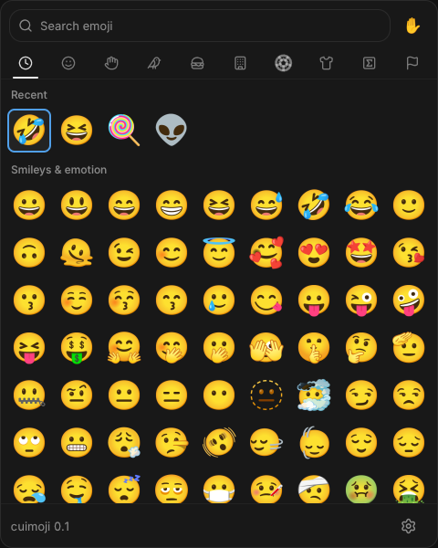

# cuimoji

A small emoji picker for Linux with a native
[CUI](https://github.com/yappologistic/CUI) interface and fast auto-paste.
It opens in about 40 ms, uses ~12 MB PSS on Wayland (~8–11 MB on X11), and is a
single process — no daemon, portal, or D-Bus service.

The picker is CUI's searchable emoji grid; cuimoji adds the desktop glue: a
settings popover, window-backend choices, remembered geometry, and a paste path
that writes Ctrl+V straight to `/dev/uinput`.



## Features

- **Grid**: recents, nine Unicode groups with Lucide tab icons, skin tones,
  and search by name.
  Matches are substring-based and also use Emojibase's tags and shortcodes
  ("burger" and "hungry" find 🍔, "rofl" finds 😆). The data
  (`emojibase-data@18.0.0/en/compact.json`, MIT) is downloaded at configure
  time and converted to a small lookup table; without it, only CUI's own names
  are searched.
- **Keyboard-first**: opens with the cursor on the first recent emoji, so
  Enter picks your most recent one. Typing switches to the search field; Down
  goes back into the grid. `Esc` closes, `F1` opens settings, `F2` cycles
  emoji sets.
- **Settings** (gear in the bottom bar, or `F1`):
  - **Theme** — Dark / Light.
  - **Emoji set** — System (Noto Color Emoji), Apple Color Emoji, or any
    `.ttf`/`.otf`/`.ttc` in `~/.local/share/cuimoji/emoji/`.
  - **Emoji size** — number field, step 2 (24–128 px).
  - **Font size** — number field, step 5 (80–150 %); this is the text scale,
    not a layout scale.
  - **Theme file** — `$XDG_STATE_HOME/cuimoji/theme` can override every CUI
    theme field: all semantic colors, tone colors, radii, control heights,
    text sizes, headings, shadows, motion, and the font-scale multiplier. It is
    created commented on first run; delete it to regenerate. Changes apply on
    the next launch.
  - **Paste delay (fallback)** — number field, step 10 ms (0–500); the wait
    used when the compositor IPC cannot be queried.
  - **Renderer** — Software, OpenGL, Vulkan. Applied on the next launch.
  - **Window system** — Auto / Wayland / X11. Auto picks the Wayland-native
    SDL2 window when a Wayland session is available, with the X11 window as
    the fallback. Applied on the next launch.
- **Bottom bar**: shows the emoji under the pointer and its name; when nothing
  is hovered it shows `cuimoji <version>`. The settings gear sits on the right.
- **Resizable window**: the grid and bottom bar follow the size. Limits are
  240×240 to 770×770.
- **Remembered geometry**: window size is restored on both backends; position
  is restored on X11 (Wayland compositors decide placement).
- **Lean and instant**: ~40 ms from launch to a visible window and ~12 MB PSS
  on Wayland (~8–11 MB on X11). No background process: the picker itself is
  the only thing running.
- **Fast auto-paste**: the emoji goes to the clipboard and Ctrl+V is written
  from a persistent `/dev/uinput` keyboard. No daemon, no portal, no D-Bus
  round trip. Terminals get Ctrl+Shift+V.
- **Single instance**: launching cuimoji again closes the running picker, so a
  keybinding toggles it instead of stacking windows.
- **Idle-friendly**: no frames are drawn while nothing moves; input, resize,
  animations, and timers wake the loop.
- Recents, skin tone, emoji font, sizes, theme, paste delay, renderer,
  window system, and window geometry are saved in
  `$XDG_STATE_HOME/cuimoji/state`.

## Build

```sh
cmake -S . -B build -DCMAKE_BUILD_TYPE=Release
cmake --build build -j
./build/cuimoji
```

Dependencies: `libx11`, and for the Wayland-native window `sdl2` +
`wayland-client`. The Vulkan renderer additionally needs `vulkan-headers`;
without SDL2/wayland-client the app builds the X11 window only. CUI v1.2.0 is
fetched by CMake.

CUI is patched by `patches/cui-fast-emoji.patch`: it draws up to 256 new emoji
per frame and keeps the 1024 texture, so the grid is complete on the first
frame instead of filling in over ~10 frames; search also falls back to plain
substring matches.

## Key binding (niri example)

```kdl
Mod+Period hotkey-overlay-title="Open cuimoji" { spawn "/path/to/cuimoji/build/cuimoji"; }

window-rule {
    match app-id=r#"^(cuimoji|CUI)$"#
    open-floating true
    default-column-width { fixed 360; }
    default-window-height { fixed 480; }
}
```

The rule keeps it floating (it is resizable, so niri would tile it otherwise)
and gives it the default 360×480 size. The app then restores whatever size it
had when it last exited. Without niri, no window rule is needed — the app runs
on X11 or Wayland directly.

## How the paste works

1. The emoji goes to the clipboard: CUI's X11 selection immediately, plus
   `wl-copy` for the Wayland clipboard (Wayland apps read that one).
2. The window is hidden so the compositor refocuses the previous window.
3. The app asks the compositor until focus has left cuimoji instead of
   sleeping blindly: `niri msg --json focused-window` on niri,
   `mmsg get focusing-client` on Mango, and `hyprctl activewindow -j` on
   Hyprland. Without compositor IPC it waits the configured fallback delay.
4. Ctrl+V is sent from the uinput keyboard opened at startup, with small
   delays between key events so Qt/Electron apps (Telegram, SereinGram) pick
   it up reliably.

Measured on this machine: ~80 ms from picking to the keypress (software
renderer; `wl-copy` is most of it, the key itself is instant).
`CUIMOJI_DEBUG=1` prints the breakdown; `CUIMOJI_GL=1` forces OpenGL.
Resident memory is ~12 MB PSS on the Wayland window (presentation goes through
`wl_shm`, so no EGL/GPU driver is mapped) and ~8–11 MB with the X11 window.

## Notes

- `/dev/uinput` needs the user in the `input` group (as with ydotool); if it
  cannot be opened, the app falls back to running `ydotool`.
- `wl-copy` (wl-clipboard) is needed to keep the clipboard after the app exits.
- Compositor IPC is optional: niri, Mango (`mmsg`) and Hyprland
  (`hyprctl`) are detected automatically. Without it the app waits a short
  fixed delay before pasting.
- `assets/lucide-cuimoji.ttf` is the Lucide subset used by the group tabs
  (the embedded CUI icons plus the eight group glyphs); CMake copies it next
  to the binary at build time.
- The Wayland window uses SDL2 for the surface, input, and IME, and presents
  CUI's software frame through double-buffered `wl_shm` buffers attached to
  SDL's surface. The X11 window uses CUI's own window and renderer.
- `vulkan/cui_vulkan.c`, `vulkan/cui_vulkan.h`, and `vulkan/ui_spv.h` are the
  small Vulkan renderer scaffold from the CUI mosaic demo
  (`cui-hello/vulkan`), reused here as the Vulkan backend.

## AI disclosure

This project was developed with substantial assistance from an AI coding agent
(OpenCode with DeepSeek V4.1 Flash). The human author directed the work,
tested the app, and reviewed the changes. Code and documentation may contain
AI-generated material; review it before reuse.

## License

cuimoji is free software: you can redistribute it and/or modify it under the
terms of the **GNU Affero General Public License, version 3 or (at your option)
any later version** (`AGPL-3.0-or-later`).

Copyright (C) 2026 NoCrypt.

See [LICENSE](LICENSE) for the full license text. Third-party components keep
their own licenses: CUI is fetched separately by CMake, and the Emojibase data
is MIT.
